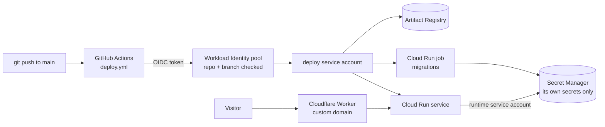

# cloudrun-blueprint

[](https://github.com/arjun-kanniah/cloudrun-blueprint/actions/workflows/ci.yml)

Terraform modules and a GitHub Actions workflow for running a containerised app on Google
Cloud Run, the way a small production app should run: deployed from GitHub without key files,
reading only its own secrets, with database migrations before each rollout, a spending alert,
and a custom domain that still streams.

It is extracted from [DocPilot](https://github.com/arjun-kanniah/docpilot), which runs on it
([live demo](https://docpilot.arjunkanniah.dev)).

## What you get

| Module | Creates |
|---|---|
| [`modules/project`](modules/project) | The APIs, a Workload Identity pool that only your repositories' deploy branch can use, and an optional monthly budget alert (50, 90, 100%). Once per project. |
| [`modules/service`](modules/service) | One app: an image repository that cleans up after itself, a runtime service account that can read only the app's secrets, the Cloud Run service (scale to zero, capped instances), optional jobs such as migrations, and a deploy service account that only the app's repository can use. |
| [`modules/cloudflare-domain`](modules/cloudflare-domain) | A custom domain through a Cloudflare Worker on the free plan, with the visitor's IP passed on and a shared secret so it can't be forged. |
| [`deploy.yml`](.github/workflows/deploy.yml) | A reusable workflow: build and push the image, run the jobs on it, roll out, and check that it answers. |



## Quick start

```hcl
module "project" {
  source = "github.com/arjun-kanniah/cloudrun-blueprint//modules/project?ref=v0.1.0"

  project_id          = "my-project"
  github_repositories = ["me/hello"]
  billing_account     = "XXXXXX-XXXXXX-XXXXXX" # optional budget alert
}

module "app" {
  source = "github.com/arjun-kanniah/cloudrun-blueprint//modules/service?ref=v0.1.0"

  project_id                  = "my-project"
  region                      = "us-central1"
  name                        = "hello"
  github_repository           = "me/hello"
  workload_identity_pool_name = module.project.workload_identity_pool_name
  health_path                 = "/healthz"

  secrets = { DATABASE_URL = "database-url" } # env var => Secret Manager secret ID
  jobs    = { migrate = { args = ["migrate"], secret_env = ["DATABASE_URL"] } }

  depends_on = [module.project]
}
```

Then deploy from the app's repository:

```yaml
jobs:
  deploy:
    if: github.ref == 'refs/heads/main'
    permissions:
      contents: read
      id-token: write
    uses: arjun-kanniah/cloudrun-blueprint/.github/workflows/deploy.yml@v0.1.0
    with:
      workload_identity_provider: ${{ vars.GCP_WIF_PROVIDER }}
      service_account: ${{ vars.GCP_DEPLOY_SA }}
      region: us-central1
      service: hello
      image: ${{ vars.IMAGE }}
      jobs: hello-migrate
      health_path: /healthz
```

[`examples/hello`](examples/hello) puts it together, with an optional custom domain, and outputs
the repository variables the workflow needs.

## Design choices

**No keys to leak.** GitHub Actions exchanges its OIDC token for short-lived Google credentials.
The pool accepts only the listed repositories' deploy branch, and each app's deploy account
trusts only its own repository, so one compromised repo can't deploy another app.

**Least privilege at runtime.** Each app runs as its own service account with access to its
own secrets, granted one secret at a time. Secret values are created outside Terraform (for
example `gcloud secrets versions add`), so they never land in Terraform state.

**Terraform owns the shape, deploys own the image.** The first apply starts a placeholder
image; after that, Terraform ignores the image, so `terraform apply` never rolls back a deploy
and a deploy never fights a plan.

**Cheap by default.** Services scale to zero and have an instance ceiling. Old images are
deleted after a day, apart from the latest three, which keeps storage in the free tier. The budget counts spending
before credits, so alerts fire even while free-trial credit is paying.

**Why a Worker for the custom domain.** Cloud Run domain mapping is in preview and offered only
in some regions, a global external load balancer costs about USD 18 a month, and Firebase
Hosting buffers responses, which breaks server-sent events. A Cloudflare Worker on the free
plan streams responses through as they arrive. Because requests then reach Cloud Run from
Cloudflare's addresses, the Worker passes the visitor's IP in a header, with a shared secret
the service checks before trusting it (for rate limits, for example):

```python
if hmac.compare_digest(request.headers.get("x-proxy-secret", ""), PROXY_SECRET):
    client_ip = request.headers.get("x-client-ip")
```

The zone itself is added in the Cloudflare dashboard, since moving nameservers is a manual
step at the registrar.

## Developing

```bash
mise install   # Terraform and just, pinned in mise.toml
just check     # format check, validate, and `terraform test` for every module and the example
```

The tests run `terraform plan` against mocked providers, so they need no cloud account. They
check that the identity condition is built correctly, that jobs only get the secrets they
list, that `public = false` really keeps the service private, and similar.

## License

MIT
